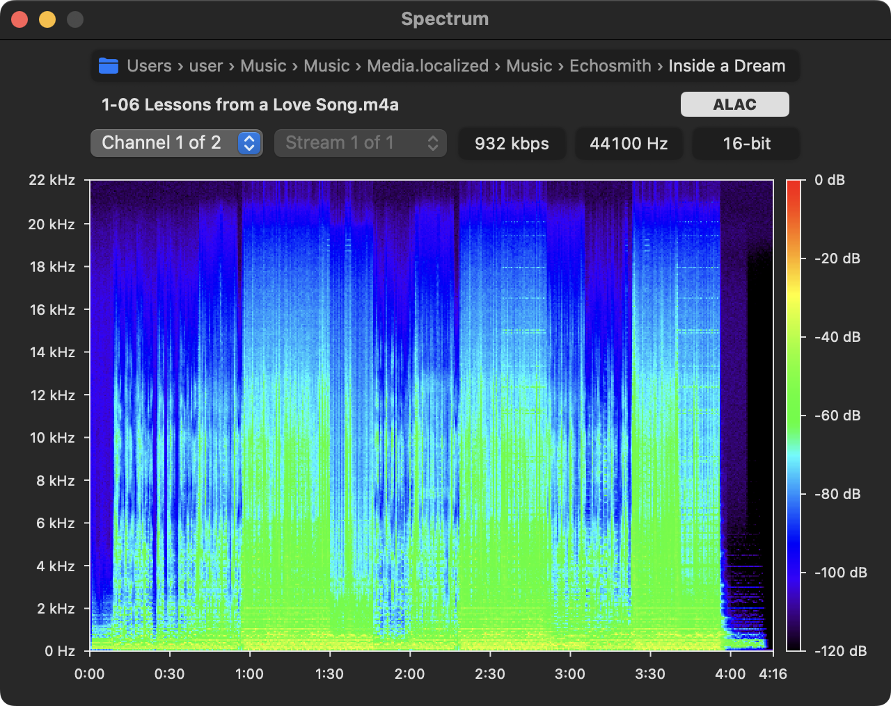

# Spectrum

A macOS 15 application for generating audio spectrograms, useful for inspecting the true spectral distribution of audio files, regardless of metadata, codec, or container.

- Export the rendered spectrogram to a PNG file.
- Optionally clamp the frequency axis scale to a specific value, regardless of the input file's own sampling frequency.
- Optionally render spectrograms for other channels and streams in the background when the application is idle to reduce wait times.
- Decoding is performed by a statically-linked, minimal build of FFmpeg 9.0.2.
- Supported codecs: FLAC, ALAC, WavPack, PCM (WAV/AIFF/CAF), DSD, AAC, MP3, AC-3/E-AC-3, DTS/DTS-HD, Dolby TrueHD/MLP, Opus, Vorbis, WMA/WMA Pro/WMA Lossless.
- Supported container formats: .mkv/.mka/.webm, .mp4/.m4a/.m4v, .mov, .avi, .ts/.m2ts/.mts, .wmv/.wma, .flac, .wv, .wav, .aif/.aiff, .caf, .dsf/.dff, .mp3, .aac, .ac3/.eac3, .dts, .thd/.mlp, .ogg/.oga/.opus.

Spek (https://github.com/alexkay/spek, Copyright © 2010–2013 Alexander Kojevnikov and contributors, GPL-3.0) is an excellent application, but the macOS build always felt like a bit of an afterthought and never looked "at home" on the platform. Spectrum aims to be a macOS-focused reimplementation of Spek with a few modern performance improvements tacked-on. That said, support for a few of the more obscure file formats was eschewed in favor of considerably slimming the included FFmpeg build.



## Installation

Spectrum is not signed with an Apple Developer ID and is not notarized. To launch it, you can either disable Gatekeeper, remove the quarantine flag manually with the command below (using the appropriate path for your installation, of course), navigate to System Settings > Privacy & Security and click "Open Anyway" after first attempting a launch, or build it yourself with Xcode (open `Spectrum.xcodeproj` in Xcode and choose Product > Build).

```sh
xattr -dr com.apple.quarantine "/Applications/Spectrum.app"
```

## System Requirements and Security

- macOS 15.6.0 or later, Apple Silicon only.
- Sandboxed, uses Apple's Hardened Runtime, and is compliant with Swift 6 (Strict Concurrency and Strict Memory Safety); built against Xcode 26.3.

## Support

If you find a bug, please report it here on GitHub and I will try to fix it. If it affects macOS 15, I will try harder. Please be as thorough in your reporting as you can.

You're welcome to request features or changes if you're so-inclined, and I will give such requests due consideration, but just know that this application was built first and foremost for an audience of one and I consider it largely feature-complete at this time.

Spectrum is available in English only, by design.

## Note

I am not a software engineer; all of the code for this project was written by Anthropic's Claude models. That said, I use all of the applications under this account regularly in my daily life, so while they're not perfect, I'm confident in their efficacy and general reliability.

## License

Spectrum is free software, licensed under the GNU General Public License, version 3 only (GPL-3.0-only). Copyright © 2026 avenged110. The full license text is in `COPYING`.

## Acknowledgments

Spectrum is a modern, macOS-focused reimplementation of Spek (https://github.com/alexkay/spek, Copyright © 2010–2013 Alexander Kojevnikov and contributors, GPL-3.0). Its palette and ruler layout are adapted from Spek; the palette is Spek's modified version of Dan Bruton's visible-spectrum algorithm. Spectrum is not affiliated with, endorsed by, or supported by these authors.

Spectrum contains code of FFmpeg 9.0.2 (https://ffmpeg.org), licensed under the GNU Lesser General Public License, version 2.1 or later, and statically linked. The build uses neither `--enable-gpl` nor `--enable-nonfree`. The LGPL text is included as `COPYING.LGPLv2.1` in the `NOTICES` folder and in the app. FFmpeg's libavcodec includes DCT code derived from the Independent JPEG Group's library. The source of the FFmpeg release used is available from https://ffmpeg.org.

The notices for Spek and FFmpeg are reproduced in the `NOTICES` folder and in the app's Credits.
